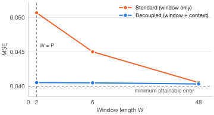

# Why Do Time Series Models Need Long Context Windows? (NeurIPS 2026)

[![NeurIPS](https://img.shields.io/badge/NeurIPS-2026-916ba4.svg?style=flat&logo=data:image/png;base64,iVBORw0KGgoAAAANSUhEUgAAACAAAAAgCAYAAABzenr0AAAGb0lEQVR42u2WbXBU5RXH/%2Bfc3c1m89qSgmI7GmQaBgQCAUuntQuE0qhMP7Ts2lYEOmUCSSS0jQkdnfHmjgpVg%2BFVApVaSaw2O%2B0HbR06RN6sSjGgtGUHkGqjgMISEgKbze7e55x%2BKGB4KSU1fmrPp3ufe%2Bd5fud/3h7gf91oID/bsDkWRCDp843ftPWh1xdOb5jv83jrxMTvcMmziBSTOj//1uwhp78yLjNOBxt31yQ%2BFYBt2xyNjqFIJGzmfNUe2vKmc7KitOGegD/3xXPJrrstWMn87GFt3fFTE4y4DoA7oMmxzP6jEAlnZ%2BuW%2BJlejQ2NJiKRiADQy8%2BwrgWwc%2BdOjUYjurD0yam5Wfk7J9wcPMVCrwlktqh8Q5g2nU2caYZFcVKM96hUr9/24OHJhd/MN6y70mn%2BjVr%2B7s2/b/xLKBSyotHo9QEolGCDi3yzZk0snD7WTWC/5UWtqAxv2la3YsyNE1q8VtaHIBnl92R%2BX8SdrSTtSnTnhMJpB0mtzI2v1v1hYuHMW0DSW1I44658d8Tbe45sSQ4oBAtLn2gvyL2ppLPn2MOum3qZvf5sNibWtH3pofIZT75DQs8S6RdBuA0wjgqXGuUtFuscFbxGlo5g0b3CdGc6oI%2BczehNRiL1aYD0mgosLluVMfnWaeNNmrekTSJXIDmW5T1O0O96vf5NEwqn9TJoPxmKNm2vXV9yy8wkEQ9jcIxEepXxNy9rl8JKAfQ9InmZU1ZjoNfzXvv7X%2B/4twrYsHl4%2BXBr/z/i4YAvp6Wnr2vTxra6BRe%2B/7Bs1Rf8Jv2Kim4TkoiPMuYaSb0khB8R%2BAUiyWDBUReUseHV2h0AUD7j8UkEnGFgOMAjDOSvG9uWtl8BoFCKhCL88bDUlK7TCXx0oruGGJbH8oVT6b7ZRNapprYH/rgg%2BESxD/Ej4smuYOahrsqOrHO8rXF3TV//LFco1aOeHDhyYa18ZsMoVi1u2lr74oU1zyckpPbo7TQkdqxE8vN%2B6ca6a57ZWvs%2BACwqfbxCIXnlwYa95NFpSSv3nMeYKbGtu8MRREz/soVzcT8BoLZts%2BPUaygU5o2RBw6WBxtOXTUEtm1z7qkvhzN9zHv3fRAoyBv6i57e2Or1bXVLFt9u5yaH5vg4boaAabvryu3P7PzZ0VCo1RodOaAOHL1ajV%2BtuqhfAl6igOM48lRF81nXYOrHp7uWZWdmlQnoDACs2eP0nIc8feyN7K9lZmbGFEoUITOwtkt63mm9QoFVlZvLlKkYRmNscX712jkrLlVKgcvoB8P4woNx6aQKdTIxK1G7HbQ9dnC756J65w%2B3YfNnMoxW3t9SB0WRqu6xwEOqn753GQCoKhENvudXVoFBsSg9FwjQ3kRCChurnv8WEXKJKKK2MjkknwXARTkF5hFlU5BMoBiEZczyIRH61la23EwOiW0PrvRXABDzKxZRXSI78WcoHhSjOWR0vEs69eflG/LGRMeQQmmwQS5uliadnpb0rKx4roLxbQI/dEPMtxyq4zK8WY%2BGI2FDIHWcf3W2wQL5JAmrfz2MjNnPxH5RsxygNLM1xTWptV54OlzSJlhay4J459q/d/RvsYOigGvSeQDvEJEFruK3CoyEYpYXgX0skgBwmAx9R4SecuBI46LmIoXSoClwwVZXbp6vxIvAXCEmNYrhKQNpAcTzmMvmrIe1Ay4Wg6nK9flurWkMJxQguo5WfE0AhVK9HfF%2BLpY8RER9DC5NizvHYkoJ8B6pBi32lqSNu8yCJPs4/e7SdQuOD14VgNRxwil4JOj6fBONmJDP41sWhzT/ZN19LxFZQSW9MZ1Mvuk3me9kcdbyFZWbRyqUWkOt1n8bDrrKuwKglVXNHcxW4Jyki5LnTniHBG66zYUp/un6uQ0rK341zuv1v5VGsvTHq%2Bf9aVBzwLZtrq%2Bv15X3twRh8JFxRfPz8t%2BI9/U8CkYUkNiSNfPePq%2BeNFa2FGf6/A/HU711NU/PPWLD5oFUyH%2BUbU3V8%2BUF%2BTdsONl1PARgsgBlAbd3UtIXuMeI9S5Ui0YMH/lcx4nDP6hee98LraFWKxwJm08N0BpqtQ6MPqD%2Bk8PyPCYwtnbj/F2rqlo%2BsCzvl4yaiTn%2BnH098e7XycJdDM9iSKpp8bp5nZfP%2B%2BseRpdbPy%2B6AOwCAFE0kJuE300ciivtJeLfLVlzbw%2BAxy65%2BPzfBmD/BFtUC1BdJU3aAAAAAElFTkSuQmCC)](https://neurips.cc/virtual/2026/loc/paris/poster/149819)
[](https://openreview.net/pdf?id=n51PuFNKYi)
[](https://arxiv.org/abs/2606.01999)

This repository contains the code and configurations to reproduce the experiments in the main text of the paper **"Why Do Time Series Models Need Long Context Windows?"** (NeurIPS 2026).  
We study how forecasting models trained on multiple time series, such as foundation models, can benefit from long input windows. We show longer observation windows are useful not only to capture long-range dependencies, but also because they allow to reduce the uncertainty about which process generated the input time series. We discuss the implications of this perspective and show how the insight it provides can be used to design more efficient forecasting models.

**Authors**: [Luca Butera](mailto:luca.butera@usi.ch), Giovanni De Felice, Andrea Cini, Cesare Alippi

---

## The paper in a nutshell

**Motivation.** Global models, i.e., models trained on groups of time series, rely on increasingly long input windows, which improve forecasting error. This improvement is usually attributed to capturing long-range dependencies. However, the window sizes selected by hyperparameter tuning are often considerably larger than the number of time lags one would consider relevant for prediction. 

**Generative Process Identification and Conditional Forecasting.** We show that learning to forecast across multiple time series can be seen as learning to address two tasks: *generative process identification* (GPI) and *conditional forecasting* (CF). Infact, assuming each time series is generated by a generative process with parameters $\boldsymbol{\phi}^n$, optimal predictions can be interpreted as a *posterior average* over plausible data-generating processes:

$$
\mathbb{E}\left[x^n_t \mid \mathbf{x}^n_{t-W:t}\right]
= \int \underbrace{\mathbb{E}\left[x^n_t \mid \mathbf{x}^n_{t-W:t}, \boldsymbol{\phi}^n\right]}_{\text{CF}}
\;\underbrace{p\left(\boldsymbol{\phi}^n \mid \mathbf{x}^n_{t-W:t}\right)}_{\text{GPI}}\, d\boldsymbol{\phi}^n
$$

- **Generative Process Identification (GPI):** inferring the process that generated the input observations.
- **Conditional Forecasting (CF):** predicting future values conditioned on past observations.

From this perspective, longer windows can improve forecasts not only by capturing temporal dependencies, but also by reducing uncertainty about which process is generating the input time series. Indeed, we prove that, under mild assumptions, even for processes with memory length $P$, a window strictly larger than $P$ is necessary to achieve the minimum attainable error. Empirically, we find that models trained on multiple domains, such as foundation models, require longer input windows than domain-specific global models to achieve comparable errors. This effect can be attributed to a larger uncertainty about the generating process when a model is trained across multiple domains.

**Implications for model design.** While the most recent observations are typically the most important for CF, GPI may also rely on observations further back in the series' history (assuming they are still representative of the same data-generating process). We show that this insight can be exploited to design more efficient models. To do so, we aim to *decouple* GPI and CF: an *embedding module* processes a long past *context* and produces a reusable embedding, which conditions a *base model* operating on a short *window* of recent observations. Compared to the standard approach of using a long contiguous window, in our experiments decoupled models often achieve comparable error with shorter windows. The figure below provides an example of this effect in a controlled environment. On *non-linear autoregressive* (NAR) processes of order $P = 2$, the decoupled model achieves near-minimum error already at window length $W = P$, while the standard model requires $W \gg P$:

<div align="center">
  <picture>
    <source media="(prefers-color-scheme: dark)" srcset="assets/gpi_context_dark.svg">
    
  </picture>
  <br>
  <sub>1-step-ahead forecasting error (MSE) of standard (orange) and decoupled (blue) global models on hold-out series generated by NAR processes of order P = 2 (mean of 3 runs).</sub>
</div>

---

## Setup & Installation

### 1. Prerequisites
- **Conda** (or Miniconda).
- A Linux machine with CUDA support for GPU acceleration.
- All commands should be executed from the repository root.

### 2. Environment Setup
Create and activate the conda environment using `environment.yaml`:

```bash
conda env create -f environment.yaml
conda activate wlcw
```

Datasets and pretrained model checkpoints are downloaded and cached automatically upon first run. Experiments on the CEREn dataset are not included, as the data is not openly available.

---

## Running Experiments

A runner script [`run_experiments.sh`](./run_experiments.sh) is provided to run the experiments used to build each figure.

### Generating Results per Figure

- **Figure 2: Pretrained Foundation Models - Contiguous vs Disconnected Regimes**  
  Generates results for the experiment evaluating pre-trained foundation models under the *contiguous* and *disconnected* input regimes:
  ```bash
  ./run_experiments.sh figure2
  ```

- **Figure 3: Controlled Context Decoupling**  
  Generates results for the experiment comparing *local* models with *standard* and *decoupled* global models in controlled environments with NAR processes:
  ```bash
  ./run_experiments.sh figure3
  ```

- **Figure 4: Controlled Single-Domain vs Multi-Domain**  
  Generates results for the experiment comparing *single-domain* and *multi-domain* global models in controlled environments with NAR processes:
  ```bash
  ./run_experiments.sh figure4
  ```

- **Figures 5 & 6: Foundation Models vs. Specialized Architectures**  
  Generates results for the experiments comparing *domain-specific global models*, *multi-domain global models*, and *pre-trained foundation models* on real-world forecasting tasks:
  ```bash
  ./run_experiments.sh figure5-6
  ```

- **Figures 7 & 8: Real-World Context Decoupling**  
  Generates results for the experiments comparing *standard* and *decoupled* models on real-world forecasting tasks:
  ```bash
  ./run_experiments.sh figure7-8
  ```


---

## Experiment Tracking

All runs log metrics and checkpoints locally using **TensorBoard**. 

To visualize metrics across experiments, launch TensorBoard in your terminal:

```bash
tensorboard --logdir outputs
```

Then open [http://localhost:6006](http://localhost:6006) in your browser.

---

## Cleanup

To remove experiment outputs, downloaded datasets, and pretrained model weights, run [`cleanup.py`](./cleanup.py) from the repository root, using the `wlcw` environment. The script lists what will be removed and asks for confirmation.

```bash
python cleanup.py
```

Then, remove the conda environment:

```bash
conda deactivate
conda env remove -n wlcw
```

---

## Citation

If you find this repository or research useful in your work, please consider citing:

```bibtex
@inproceedings{butera2026why,
  title={Why Do Time Series Models Need Long Context Windows?},
  author={Luca Butera and Giovanni De Felice and Andrea Cini and Cesare Alippi},
  booktitle={The Fortieth Annual Conference on Neural Information Processing Systems},
  year={2026},
  url={https://openreview.net/forum?id=n51PuFNKYi}
}
```
